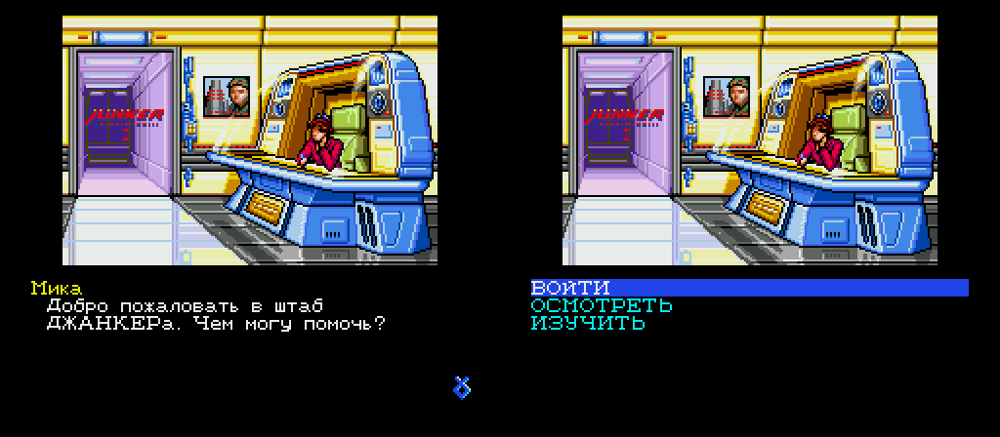
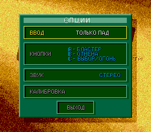

# Snatcher — русский перевод (Sega CD)

Русский перевод американской версии *Snatcher* для Sega CD (Konami, 1994).
Текст берётся из русского перевода PlayStation-версии
([andruxaster/snatcher-translated-rus](https://github.com/andruxaster/snatcher-translated-rus))
и подгоняется под американскую локализацию.

**Статус: черновой перевод всего сценария.** Все 39 файлов сценария
(10 599 строк), имена говорящих и меню переведены и собираются в образ;
начало игры проверено в эмуляторе. Переведены и экраны вне сценария:
меню заставки, опции, файлы сохранения, выбор и ошибки памяти,
предупреждение и посвящение, заставки актов и печатающаяся подпись над
городом. Текст ещё не вычитан.



## Что уже работает

- Кириллица в шрифте игры: 66 букв 8×8 в стиле родного пропорционального
  шрифта, две вставки в код вывода текста (`tools/fontpatch.py`).
- Правка файлов прямо в образе: каталог ISO и EDC/ECC секторов
  пересчитываются, образ годится и для эмулятора, и для записи на диск
  (`tools/cdimage.py`).
- Строки можно переписывать любой длины: текст каждого файла сценария
  раскладывается заново, а игра находит строку по таблице «старое смещение →
  новое» (`tools/textpatch.py`, `tools/textmap.s`); байт-код не трогается.
  Проверено тестом сдвига: весь английский текст переложен — игра идёт как
  обычно.

Как устроен движок — [docs/ENGINE.md](docs/ENGINE.md).



## Как переведено

Источник — американский английский текст Sega CD. Для 3 780 строк из 10 599
нашлась близкая строка PlayStation-версии, и её русский перевод
([snatcher-translated-rus](https://github.com/andruxaster/snatcher-translated-rus))
взят за основу; остальное переведено заново по тому же глоссарию с
поправками на американскую версию (Джордан, Катрина, турбоцикл) —
[text/GLOSSARY.md](text/GLOSSARY.md). Перевод сделан с помощью ИИ.

Русский текст — `text/ru/SPxx.json` (смещение строки → текст, уже с
переносами по ширине окна: 200 px в диалоге, 158 px в базе Джордана).

## Дальше

1. Вычитка в игре: пароль Наполеона (выбор из меню), загадка Катрины,
   база Джордана.

## Установка патча

Готовый патч — в [релизах](https://github.com/andruxaster/snatcher-segacd-rus/releases):
xdelta для первой дорожки образа redump *Snatcher (USA)*, инструкция в
README.txt внутри архива. Остальные дорожки и .cue не меняются.

## Сборка

Нужен свой образ *Snatcher (USA)* для Sega CD в формате redump (21 дорожка,
BIN/CUE), Python 3.10+, binutils для m68k
(`apt install binutils-m68k-linux-gnu`).

```sh
python3 build.py discs /путь/к/образу       # копирует дорожки в discs/segacd_us/
python3 build.py build                      # patched/Snatcher (USA).cue
python3 build.py release                    # + release/Snatcher-SegaCD-RU-v<версия>.zip
python3 build.py build --shift-test         # проверка переадресации: всё по-английски, текст сдвинут
```

Для проверки в эмуляторе без окна (`tools/emurun.py`) нужны ядро
Genesis Plus GX (libretro) и BIOS Sega CD (USA) `bios_CD_U.bin`; пути — в
переменных `RETRO_CORES` и `BIOS_DIR`.

## Лицензия

Код — MIT ([LICENSE](LICENSE)), текст перевода и документация —
CC BY-NC-SA 4.0 ([LICENSE-DATA](LICENSE-DATA)). *Snatcher* © Konami; данных
игры в репозитории нет.
